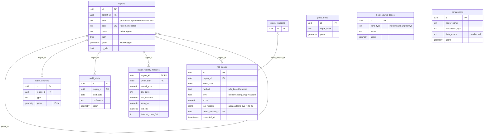
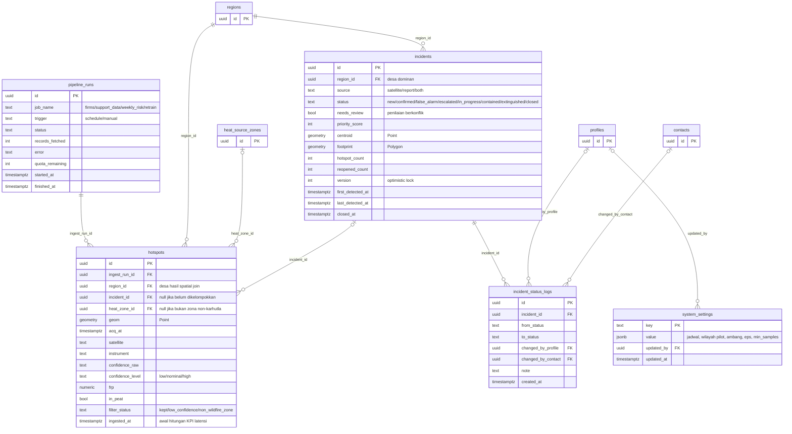
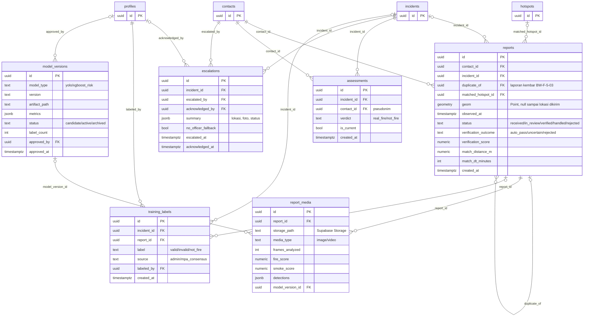
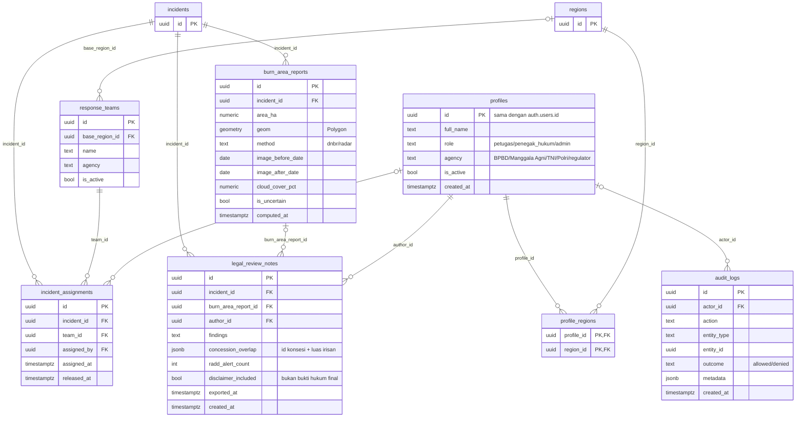
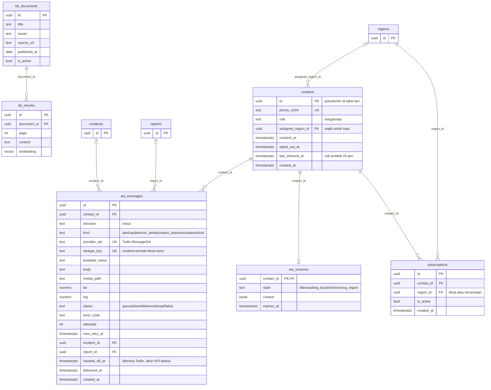

# BaraWatch — ERD & Struktur Project

Turunan dari Proposal Inception (BW-F-1 s.d. BW-F-28) · Next.js + FastAPI + Supabase + Twilio · 30 Oktober 2026

## 1. Ringkasan Arsitektur & Keputusan

| Komponen | Teknologi | Tanggung jawab | Hosting |
| --- | --- | --- | --- |
| Web + API | Next.js (App Router, TypeScript) | UI publik dan dashboard, Route Handlers, webhook WhatsApp, orkestrasi pipeline, satu-satunya penulis ke database | Vercel |
| Layanan AI | FastAPI (Python) | DBSCAN, YOLO, spatial-temporal matching, risk scoring; nanti dNBR, XGBoost, RAG chatbot. Stateless | Container terpisah (Railway, Render, Fly.io, atau VPS) |
| Data | Supabase: PostgreSQL + PostGIS, Auth, Storage | Penyimpanan data, login dashboard, foto bukti laporan | Supabase |
| WhatsApp | Twilio, dibungkus adapter | Pesan masuk dan keluar, status pengiriman | Twilio |
| Penjadwal | GitHub Actions schedule | Memanggil `/api/cron/*` dengan secret | GitHub |

Keputusan utama:

- **Next.js adalah satu-satunya penulis database.** FastAPI tidak punya koneksi ke database. Aturan bisnis (RBAC, state machine insiden, audit log) cukup hidup di satu tempat, dan skema cukup dikenal satu service. Pengecualian baru muncul di fase 3 (pelatihan ulang model): Next.js mengekspor label ke Storage, FastAPI membacanya dari sana.
- **FastAPI di luar Vercel.** PyTorch, OpenCV, dan bobot YOLO terlalu berat untuk serverless function. Ini perubahan dari proposal, yang hanya menyebut Vercel. FastAPI hanya dipanggil dari server Next.js (header `X-Internal-Key`), tidak pernah dari browser.
- **PostGIS wajib diaktifkan.** Spatial join hotspot ke desa, gambut, dan zona non-karhutla memakai `ST_Intersects` dan `ST_DWithin`. Ekstensi lain: `pg_trgm` (pencarian nama desa yang mirip, BW-F-1-01), `ltree` (hierarki wilayah), `vector` (RAG chatbot, fase 3).
- **Penjadwal tetap GitHub Actions** sesuai proposal. Jadwal GitHub bisa telat beberapa menit saat sedang padat, jadi kesegaran data bergantung pada itu, sedangkan KPI latensi 5 menit dihitung sejak data diterima sistem.
- **Twilio dipasang lewat adapter** supaya bisa diganti tanpa menyentuh logika bisnis. Penilaian lengkap ada di bagian 6.

## 2. Alur Data Utama

**A. Satelit sampai alert (MVP)**

1. GitHub Actions memanggil `POST /api/cron/ingest-hotspots` dengan `CRON_SECRET`.
2. Next.js menarik data FIRMS untuk bounding box Kalimantan Tengah, lalu upsert ke `hotspots` tanpa duplikat dan mencatat `pipeline_runs`.
3. Penyaringan: ambang confidence, penandaan zona non-karhutla (`heat_source_zones`), spatial join ke `regions` dan `peat_areas`. Hotspot yang tersaring tetap disimpan dengan `filter_status` agar tidak ditarik ulang terus dan tetap bisa diaudit.
4. Hotspot yang lolos dan insiden yang masih terbuka dikirim ke FastAPI `POST /v1/cluster` (DBSCAN metrik haversine; `eps` dan `min_samples` dibaca dari `system_settings`).
5. Klaster yang berdekatan dengan insiden terbuka memperbarui insiden itu, sisanya membuat insiden baru. Next.js menulis `incidents`, lalu mengisi outbox `wa_messages` dengan `dedupe_key` supaya perkembangan insiden yang sama terkirim sebagai update, bukan alert baru (BW-F-2-02).
6. Dispatcher mengirim lewat Twilio memakai template; callback status memperbarui `wa_messages.status`. Pengiriman gagal dicoba ulang oleh `cron/flush-outbox` (BW-F-2-03).
7. MPA membalas “Api nyata” atau “Bukan”. Webhook menulis `assessments` (append-only), memperbarui status insiden, dan menandai `needs_review` bila penilaian berbeda (BW-F-8-03).

**B. Laporan warga (Fase 2)**

1. Warga mengirim foto dan lokasi. Webhook Twilio memverifikasi signature dan bersifat idempotent lewat `MessageSid`.
2. Media diunduh dari URL Twilio lalu disimpan ke Supabase Storage agar data bukti tidak bergantung pada Twilio.
3. Next.js memanggil FastAPI `POST /v1/vision/detect` (YOLO), mencari hotspot kandidat lewat PostGIS (`ST_DWithin` plus jendela waktu), lalu memanggil `POST /v1/matching/score`.
4. Hasilnya `auto_pass` (lanjut ke MPA), `uncertain` (masuk antrean admin, BW-F-5-04), atau `rejected`. Laporan kembar digabung lewat `reports.duplicate_of`.

## 3. ERD

Total 32 tabel, dibagi menjadi lima diagram per domain supaya terbaca. Setiap diagram hanya menampilkan kolom kunci; kotak yang hanya berisi `id` adalah rujukan ke tabel yang didefinisikan lengkap di diagram lain.

Konvensi:

- Primary key `uuid`; semua waktu `timestamptz` (UTC); semua geometri EPSG:4326; enum memakai `text` + `CHECK` supaya mudah diubah lewat migrasi.
- Tabel `contacts`, `reports`, `report_media`, `assessments`, `wa_messages`, dan `concessions` tidak dibuka ke role `anon`. Data publik (peta, daftar kejadian) lewat Route Handler atau view yang sudah disanitasi (`public_incidents_v`, `public_reports_v`) tanpa nomor telepon, foto, atau identitas pelapor (BW-F-5-06, BW-F-7-02).
- `contacts.id` dipakai sebagai pseudonim di `assessments` dan tabel lain, sehingga nomor telepon hanya ada di satu tabel.
- Constraint dan index penting: unique `hotspots (geom, acq_at, satellite, instrument)`; GiST pada semua kolom `geom`; trigram pada `regions.name`; unique `wa_messages.provider_sid` dan `wa_messages.dedupe_key`; unique `risk_scores (region_id, week_start, method)`; unique parsial `subscriptions (contact_id, region_id) WHERE is_active`.
- `incidents.version` dipakai untuk optimistic locking saat dua petugas mengubah status bersamaan (BW-F-14-03).

### 3.1 Wilayah, lapisan spasial, dan risiko

`regions` adalah satu tabel hierarki (provinsi sampai desa) dengan `parent_id` dan `path` (ltree), sehingga pelanggan kecamatan otomatis ikut menerima alert desa di bawahnya. Gambut, zona non-karhutla, dan konsesi tidak punya FK ke wilayah; hubungannya lewat spatial join.



Skor risiko dihitung per desa per minggu dari `region_weekly_features`; `method` membedakan rule-based (lebih dulu) dari XGBoost (fase lanjutan), dan `top_reasons` dipakai untuk balasan bot (BW-F-4-01).

### 3.2 Deteksi satelit sampai insiden

Hotspot masuk lewat `pipeline_runs`, disaring, lalu dikelompokkan menjadi `incidents`. Satu insiden bisa lahir dari satelit, laporan warga, atau keduanya (`source`). Status hanya satu kolom, riwayatnya di `incident_status_logs`; konflik penilaian ditandai `needs_review`, bukan status tersendiri. Alurnya: `new` → `confirmed` → `escalated` → `in_progress` → `contained` → `extinguished` → `closed`, dengan cabang `false_alarm`. Hotspot baru di lokasi yang sama dalam 24 jam setelah `closed` membuka kembali insiden yang sama (BW-F-15-01) dan menaikkan `reopened_count`.



`hotspots.ingested_at` dan `wa_messages.handed_off_at` (diagram 3.5) menjadi dua ujung pengukuran KPI latensi P95 ≤ 5 menit. Hotspot yang tersaring tetap disimpan dengan `filter_status` agar tidak ditarik ulang terus dan tetap bisa diaudit.

### 3.3 Laporan warga, penilaian MPA, dan label AI

Laporan masuk lewat `reports` dan `report_media` (hasil YOLO per berkas). Penilaian MPA bersifat append-only di `assessments`; `is_current` menandai penilaian terbaru per pasangan insiden dan kontak, riwayat tetap utuh (BW-F-8-02). Label akhir admin masuk ke `training_labels` (tepat satu dari `incident_id` atau `report_id` terisi, dijaga `CHECK`) dan menjadi bahan latih; `model_versions` mencatat setiap versi model yang pernah dipakai.



Penilaian yang berbeda antar MPA pada insiden yang sama menyalakan `incidents.needs_review` dan memasukkannya ke antrean admin (BW-F-8-03). Eskalasi tanpa petugas terdaftar di wilayah itu disimpan dengan `no_officer_fallback = true` dan memicu pesan kontak darurat (BW-F-9-03).

### 3.4 Penanganan, telaah pasca-kejadian, akun, dan audit

`response_teams` dan `incident_assignments` muncul di rancangan UI (Gambar 18, “Mengerahkan Tim”) tetapi belum punya kode BW-F; saya masukkan sebagai tabel opsional untuk fase lanjutan. `burn_area_reports` menyimpan luas, poligon, tanggal citra, dan `is_uncertain` bila citra tertutup awan (BW-F-16-02). `profile_regions` membatasi petugas ke wilayahnya. `audit_logs` mencatat akses data konsesi, akses yang ditolak, dan perubahan akun (BW-F-17-02, BW-F-18-02, BW-F-24-03).



Peran dashboard hanya tiga (`petugas`, `penegak_hukum`, `admin`) karena Warga dan MPA tidak punya akun. Pewarisan hak (Admin mencakup Petugas) diterapkan di kode `rbac.ts`, bukan di database, sedangkan `penegak_hukum` sengaja tidak mewarisi apa pun.

### 3.5 WhatsApp, langganan, dan chatbot

`wa_messages` berfungsi ganda sebagai log pesan dan outbox: baris keluar dibuat dulu berstatus `queued`, dikirim dispatcher, lalu diperbarui oleh callback Twilio. `contacts.last_inbound_at` menentukan apakah pesan boleh berupa teks bebas (dalam 24 jam sejak warga terakhir menulis) atau wajib template (lihat bagian 6). `wa_sessions` menyimpan state percakapan singkat, misalnya menunggu lokasi (BW-F-5-01). Tabel `kb_*` untuk RAG chatbot baru dipakai di fase jangka panjang.



**Cakupan terhadap kebutuhan fungsional.** BW-F-1 sampai BW-F-28 semuanya punya tabel pendukung, kecuali dua: akses jalan terdekat (BW-F-13-01) yang cukup diambil dari OpenStreetMap saat runtime, dan perkiraan arah sebar api (BW-F-13-03) yang belum punya model maupun tabel dan masuk jangka panjang.

## 4. Struktur Project

Satu repo dengan dua aplikasi (`web` dan `ai-service`), tanpa tool monorepo tambahan. Tanpa penanda berarti MVP; `[F2]` = Pengembangan Lanjutan; `[F3]` = Jangka Panjang.

```text
barawatch/
├─ apps/
│  ├─ web/                                   # Next.js (App Router, TypeScript)
│  │  ├─ src/
│  │  │  ├─ app/
│  │  │  │  ├─ (public)/                     # tanpa login
│  │  │  │  │  ├─ page.tsx                   # portal publik: risiko desa, statistik
│  │  │  │  │  ├─ peta/page.tsx              # peta hotspot, filter wilayah dan waktu
│  │  │  │  │  └─ kejadian/                  # daftar riwayat + detail; form lapor web [F2]
│  │  │  │  ├─ (auth)/login/page.tsx
│  │  │  │  ├─ (dashboard)/                  # layout memeriksa sesi dan peran
│  │  │  │  │  ├─ admin/                     # pipeline, parameter (MVP); review, model, akun, kontak MPA
│  │  │  │  │  ├─ petugas/                   # [F2] kejadian, peta verifikasi, tim
│  │  │  │  │  └─ penegak-hukum/             # [F3] laporan area terbakar, telaah citra
│  │  │  │  └─ api/
│  │  │  │     ├─ webhooks/whatsapp/route.ts  # pesan masuk + status callback
│  │  │  │     ├─ cron/                       # dipanggil GitHub Actions
│  │  │  │     │  ├─ ingest-hotspots/route.ts
│  │  │  │     │  ├─ fetch-support-data/route.ts
│  │  │  │     │  ├─ weekly-risk/route.ts     # [F2]
│  │  │  │     │  └─ flush-outbox/route.ts
│  │  │  │     └─ public/                     # read-only, data sudah disanitasi
│  │  │  │        ├─ hotspots/route.ts
│  │  │  │        ├─ incidents/route.ts
│  │  │  │        └─ risk/route.ts
│  │  │  ├─ modules/                       # logika domain, satu folder per fitur
│  │  │  │  ├─ hotspots/                   # firms-client, filter, ingest.service, repo
│  │  │  │  ├─ incidents/                  # state-machine, service, repo, schemas
│  │  │  │  ├─ subscriptions/
│  │  │  │  ├─ assessments/                # penilaian MPA + deteksi konflik
│  │  │  │  ├─ notifications/              # outbox, dispatcher, retry, dedupe, template
│  │  │  │  ├─ whatsapp/                   # provider.ts (interface), twilio.ts, router.ts, flows/
│  │  │  │  ├─ admin/                      # pipeline, settings, labels, models, accounts
│  │  │  │  ├─ audit/
│  │  │  │  ├─ escalations/                # [F2]
│  │  │  │  ├─ reports/                    # [F2]
│  │  │  │  ├─ risk/                       # [F2]
│  │  │  │  ├─ burn-area/                  # [F3]
│  │  │  │  └─ chatbot/                    # [F3]
│  │  │  ├─ lib/
│  │  │  │  ├─ supabase/{server,browser,admin}.ts
│  │  │  │  ├─ ai-client.ts                # klien FastAPI, tipe dari OpenAPI
│  │  │  │  ├─ auth/rbac.ts                # peran + cakupan wilayah
│  │  │  │  ├─ cron-auth.ts                # cek CRON_SECRET
│  │  │  │  └─ env.ts                      # validasi environment variable
│  │  │  ├─ components/{map,incident,charts,layout,ui}/
│  │  │  └─ middleware.ts
│  │  ├─ tests/
│  │  └─ .env.example
│  │
│  └─ ai-service/                            # FastAPI
│     ├─ app/
│     │  ├─ main.py
│     │  ├─ api/v1/{cluster,vision,matching,risk,burn_area,chat,models}.py
│     │  ├─ core/{config,security,logging}.py   # security = cek X-Internal-Key
│     │  ├─ schemas/                            # model Pydantic = kontrak API
│     │  └─ services/
│     │     ├─ clustering/dbscan.py             # haversine, eps dalam km
│     │     ├─ vision/{yolo_detector,video_frames}.py      # [F2]
│     │     ├─ matching/spatiotemporal.py       # [F2]
│     │     ├─ risk/{rule_based,xgboost_model}.py          # rule_based [F2], xgboost [F3]
│     │     ├─ burn_area/dnbr.py                # [F3]
│     │     ├─ rag/{embed,retriever,answer}.py # [F3]
│     │     └─ registry.py                      # memuat model versi aktif
│     ├─ weights/                            # di-gitignore; diunduh dari Storage saat start
│     ├─ tests/
│     ├─ Dockerfile
│     └─ pyproject.toml
│
├─ packages/
│  └─ ai-contract/                           # openapi.json dari FastAPI -> tipe TypeScript
│
├─ supabase/
│  ├─ migrations/                            # 0001_extensions, 0002_regions, ... + kebijakan RLS
│  ├─ seed/                                  # batas wilayah Kalteng, gambut, zona non-karhutla
│  └─ config.toml
│
├─ .github/workflows/
│  ├─ cron-ingest.yml                        # schedule -> curl /api/cron/*
│  ├─ ci-web.yml
│  ├─ ci-ai.yml
│  └─ deploy-ai.yml
│
├─ docs/                                     # proposal, ERD, catatan keputusan
└─ README.md
```

Aturan yang menjaga struktur tetap rapi:

- **Route handler tipis:** validasi input, panggil service di `modules/`, kembalikan respons. Semua query database hanya ada di `repo.ts` tiap modul; komponen UI tidak mengimpor `repo`.
- **Adapter WhatsApp:** `provider.ts` mendefinisikan `WhatsAppProvider` (`sendTemplate`, `sendText`, `sendMedia`, `parseInbound`, `verifyWebhook`). Hanya `twilio.ts` yang mengimpor SDK Twilio, jadi pindah ke Meta Cloud API cukup mengganti satu file.
- **Dua klien Supabase:** `admin.ts` (service role) hanya dipakai di route handler server seperti cron dan webhook. Dashboard memakai klien sesi pengguna sehingga RLS tetap berlaku.
- **Kontrak AI contract-first:** FastAPI menghasilkan `openapi.json`, lalu `packages/ai-contract` mengubahnya menjadi tipe TypeScript untuk `ai-client.ts`.

Environment variable minimum:

```text
SUPABASE_URL, SUPABASE_ANON_KEY, SUPABASE_SERVICE_ROLE_KEY
FIRMS_MAP_KEY
AI_SERVICE_URL, AI_INTERNAL_KEY
CRON_SECRET
TWILIO_ACCOUNT_SID, TWILIO_AUTH_TOKEN, TWILIO_WHATSAPP_FROM
```

## 5. Kontrak Next.js ↔ FastAPI

FastAPI hanya menghitung; ia tidak membaca atau menulis database. Semua endpoint dipanggil dari server Next.js dengan header `X-Internal-Key`, tidak pernah dari browser.

| Endpoint | Fase | Input | Output |
| --- | --- | --- | --- |
| `GET /health` | MVP | (kosong) | status dan versi model aktif |
| `POST /v1/cluster` | MVP | hotspot yang lolos filter, insiden terbuka, `eps_km`, `min_samples` | klaster (id anggota, centroid, hull) dan `matched_incident_id` bila dekat insiden terbuka |
| `POST /v1/vision/detect` | F2 | URL media bertanda tangan (foto atau video) | skor api dan asap, kotak deteksi, versi model |
| `POST /v1/matching/score` | F2 | laporan (lokasi, waktu, skor visual) dan hotspot kandidat | skor verifikasi, jarak (m), selisih waktu (menit), hasil `auto_pass`, `uncertain`, atau `rejected` |
| `POST /v1/risk/score` | F2 | fitur mingguan per desa | level, skor, alasan utama |
| `POST /v1/burn-area/dnbr` | F3 | geometri insiden dan tanggal selesai | luas (ha), poligon, tanggal citra, penanda tidak pasti |
| `POST /v1/chat/answer` | F3 | pertanyaan warga | jawaban dengan sitasi dokumen, atau “tidak tahu” |
| `POST /v1/models/train`, `/activate` | F3 | rujukan dataset label di Storage | metrik dibanding versi aktif; aktivasi hanya setelah persetujuan admin |

Perilaku saat FastAPI tidak tersedia:

- **Pipeline hotspot:** hotspot tetap disimpan, klasterisasi ditunda, `pipeline_runs` dicatat gagal, dan admin diberi tahu (BW-F-20-01). Alert tidak dikirim dari data yang belum diklasterkan.
- **Laporan warga:** laporan masuk sebagai `uncertain` ke antrean admin, tidak diteruskan otomatis (BW-F-5-04).

## 6. WhatsApp: Twilio atau bukan?

Pakai Twilio, tetapi lewat adapter dan mulai dari Sandbox untuk demo. Untuk produksi, proses pendaftaran sender sebaiknya dimulai paralel sejak awal karena tidak bisa dipercepat. Harga di bawah tidak saya cantumkan angkanya; cek halaman harga Twilio dan Meta yang terbaru.

| Opsi | Cocok untuk | Catatan |
| --- | --- | --- |
| Twilio Sandbox | Demo hackathon, pengujian MVP | Aktif dalam hitungan menit. Setiap penguji harus “join” sandbox dulu, jadi tidak untuk publik |
| Twilio sender produksi | Pilot di Kalimantan Tengah | Butuh verifikasi bisnis Meta, nomor terdaftar, dan template yang disetujui. Biaya per pesan terdiri dari tarif Twilio ditambah tarif Meta |
| Meta WhatsApp Cloud API langsung | Produksi jangka panjang | Tanpa lapisan Twilio, tetapi setup lebih panjang. Aturan template sama |
| whatsapp-web.js dan sejenisnya (tidak resmi) | Eksperimen saja | Risiko nomor diblokir, butuh proses yang selalu hidup (tidak bisa di Vercel), dan tidak layak untuk peringatan keselamatan |

**Alasan memilih Twilio:** webhook-nya HTTP biasa sehingga cocok dengan Route Handler Next.js di Vercel; callback status per pesan langsung memberi data untuk KPI “pesan berhasil dikirim ≥ 95%”; ada Sandbox untuk pengembangan.

**Yang membuat ragu itu wajar:**

1. **Template wajib untuk pesan yang kita mulai.** Alert hampir selalu dikirim di luar jendela 24 jam sejak warga terakhir menulis, jadi harus berupa template yang disetujui Meta. Template yang perlu didaftarkan: `alert_baru`, `alert_update`, `risiko_mingguan`, `status_laporan`, `eskalasi_terkonfirmasi`.
2. **Biaya per pesan.** Alert ke banyak pelanggan dan ringkasan mingguan bisa mahal. Mitigasinya sudah ada di desain: `dedupe_key` (update, bukan alert baru), pembatasan notifikasi berulang, dan persetujuan pengguna (`consent_at`).
3. **Verifikasi bisnis Meta biasanya meminta badan atau organisasi.** Saya belum memastikan syarat tepatnya untuk tim mahasiswa; cek dokumentasi Twilio. Bisa jadi akun perlu dimiliki kampus atau mitra seperti BPBD.

Implikasi desain yang sudah dimasukkan: `contacts.last_inbound_at` dan `wa_messages.template_name`, `provider_sid` unik untuk idempotensi webhook, verifikasi header `X-Twilio-Signature`, dan antarmuka `WhatsAppProvider`. Tombol “Api nyata / Bukan” (BW-F-8) bisa memakai quick reply dari Content Template, dengan cadangan balasan teks “1” atau “2” agar alur penilaian tetap jalan bila tombol tidak tersedia.

## 7. Yang Perlu Diputuskan dan Urutan Build MVP

Empat hal ini tidak dijawab proposal, jadi saya beri asumsi sementara di desain:

1. **Onboarding MPA dan perangkat desa.** Siapa yang mendaftarkan dan memverifikasi nomor mereka? Asumsi saya: admin menambah kontak MPA per desa (`contacts.role = 'mpa'`, `assigned_region_id` terisi) lewat halaman admin. Kebutuhan ini belum ada di BW-F-24, yang hanya mengatur akun dashboard.
2. **Pemilik akun WhatsApp Business untuk produksi:** tim, kampus, atau mitra BPBD (lihat bagian 6).
3. **Tim atau regu pemadam** (`response_teams`, `incident_assignments`): masuk fase lanjutan, atau cukup status teks dulu?
4. **Hosting FastAPI dan interval tarik FIRMS.** Usulan awal interval 30 menit, bisa diubah lewat `system_settings` tanpa deploy ulang; sesuaikan dengan batas request FIRMS (BW-F-25-01).

Urutan build MVP yang disarankan:

1. Migrasi database (ekstensi, `regions`, `hotspots`, `incidents`, `contacts`, `subscriptions`, `wa_messages`, `assessments`) dan seed batas wilayah Kalimantan Tengah.
2. `ingest-hotspots` + FastAPI `/v1/cluster`, diuji dengan data historis FIRMS.
3. Peta publik dan daftar kejadian dari `api/public/*`.
4. Twilio Sandbox: berlangganan wilayah, alert lewat template, callback status.
5. Penilaian MPA lewat balasan WhatsApp, termasuk deteksi konflik.
6. Halaman admin untuk memantau pipeline dan mengatur parameter.
