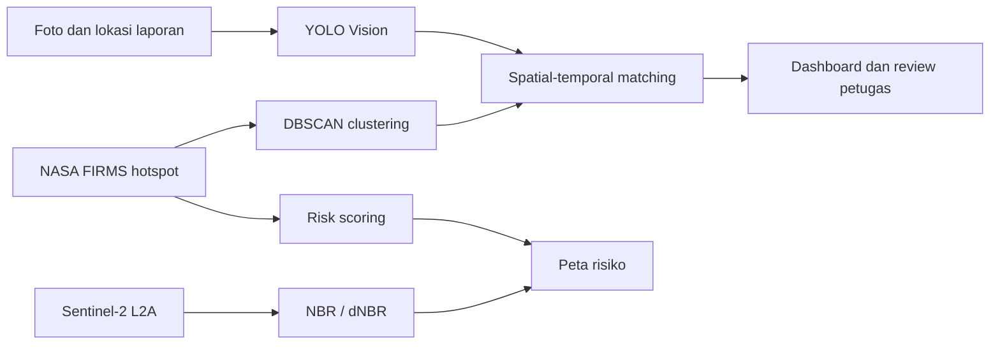
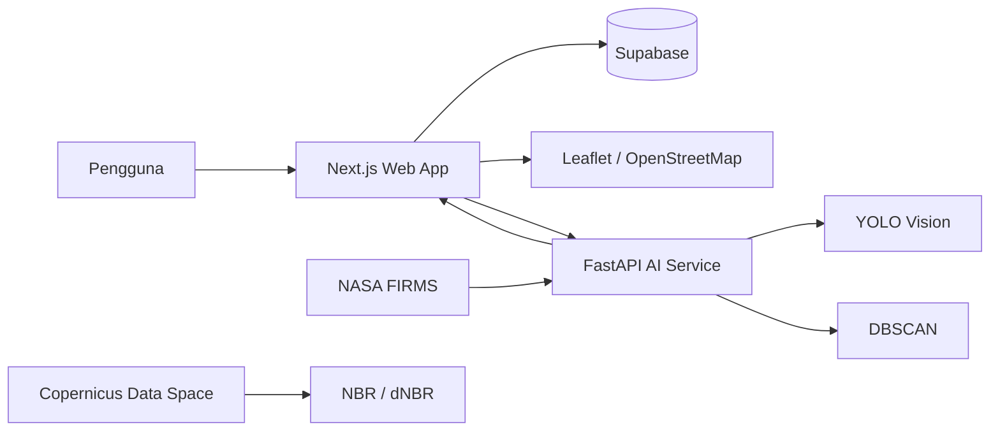

# BaraWatch

Platform pemantauan kebakaran hutan dan lahan untuk Kalimantan Tengah. BaraWatch
menggabungkan laporan masyarakat, data hotspot satelit, analisis citra, peta
interaktif, dan alur penanganan berbasis peran dalam satu aplikasi.

> BaraWatch adalah sistem pendukung keputusan. Hasil deteksi satelit, model
> visi, matching, risk scoring, dan burn-area bukan pengganti verifikasi
> lapangan atau sistem tanggap darurat resmi.

## Fitur utama

### Aplikasi web

Aplikasi web dibangun dengan Next.js dan menyediakan:

- Dashboard sesuai peran pengguna: warga, petugas, admin, dan penegak hukum.
- Autentikasi, sesi pengguna, logout, dan pengaturan hak akses berbasis peran.
- Peta interaktif untuk melihat hotspot, insiden, risiko desa, batas wilayah,
  dan laporan masyarakat.
- Filter lokasi berantai Kabupaten → Kecamatan → Desa.
- Daftar laporan dengan pencarian, filter, detail progres, dan pemuatan data
  bertahap melalui tombol **Muat lebih banyak**.
- Form pelaporan api/asap dengan:
  - pemilihan desa,
  - pemilihan titik lokasi melalui peta,
  - koordinat latitude/longitude read-only yang mengikuti pin,
  - unggah foto JPG/JPEG dan persetujuan publikasi foto hasil anotasi.
- Tampilan status dan alur tindak lanjut laporan.
- Integrasi Supabase untuk database, autentikasi, dan penyimpanan media.

### Layanan AI

Layanan AI adalah service FastAPI terpisah di [`apps/ai-service`](./apps/ai-service)
yang menyediakan endpoint untuk:

- Clustering hotspot berbasis waktu dan lokasi.
- Deteksi api/asap dari foto menggunakan dua model YOLO.
- Matching laporan masyarakat dengan hotspot berdasarkan bukti visual,
  lokasi, dan waktu.
- Filtering kualitas hotspot.
- Risk scoring berbasis aktivitas hotspot dan FRP.
- Estimasi indikasi perubahan area terbakar melalui Sentinel-2 dan dNBR.

Endpoint dan batasan teknis selengkapnya tersedia di
[`apps/ai-service/README.md`](./apps/ai-service/README.md).

## Penerapan AI dalam aplikasi

AI BaraWatch diterapkan pada alur pemantauan dan peninjauan kebakaran, bukan
hanya sebagai service terpisah. Saat juri menggunakan aplikasi, penerapan AI
dapat dilihat pada fitur-fitur berikut:

| Fitur yang terlihat di aplikasi | Penerapan AI | Hasil yang digunakan aplikasi |
|---|---|---|
| **Peta hotspot dan kelompok titik api** | Hotspot NASA FIRMS dikelompokkan menggunakan **DBSCAN** dengan jarak Haversine dan pemisahan berdasarkan waktu. | Cluster hotspot, centroid, anggota cluster, noise, serta kandidat insiden yang berdekatan untuk ditampilkan di peta dan diprioritaskan. |
| **Pelaporan api/asap dengan foto** | Foto laporan diproses oleh **dua model YOLOv8** melalui Ultralytics/PyTorch. | Kelas api/asap, confidence, bounding box, ringkasan indikator, dan gambar anotasi untuk membantu peninjauan laporan. |
| **Pencocokan laporan dengan hotspot** | Modul **spatial-temporal matching** menggabungkan hasil visi, jarak lokasi, dan selisih waktu dengan hotspot satelit. | Skor pencocokan, alasan keputusan, dan status `auto_pass`, `uncertain`, atau `rejected` sesuai aturan modul. |
| **Prioritas risiko wilayah** | **Risk scoring** menghitung indeks aktivitas dari jumlah hotspot, rasio hotspot eligible, dan FRP. | Skor risiko, kategori tingkat aktivitas, alasan penilaian, serta status `insufficient_data` jika data belum memadai. |
| **Estimasi perubahan area terbakar** | Citra Sentinel-2 L2A diproses dengan **NBR/dNBR**, masking SCL, NumPy, dan Rasterio. | Indikasi perubahan area, cakupan piksel valid, estimasi area indikatif, dan informasi ketidakpastian. |

Secara teknis, halaman web berkomunikasi dengan service AI melalui endpoint
FastAPI di [`apps/ai-service/app/api/v1`](./apps/ai-service/app/api/v1).
Implementasi algoritma berada di
[`apps/ai-service/app/services`](./apps/ai-service/app/services), sedangkan
aplikasi Next.js menampilkan hasilnya pada dashboard, peta, detail laporan,
dan alur peninjauan petugas.

Alur sederhananya:



Dengan demikian, AI digunakan untuk membantu **mendeteksi**, **mengelompokkan**,
**mencocokkan**, dan **memprioritaskan** informasi kebakaran. Keputusan akhir
tetap memerlukan pemeriksaan manusia dan verifikasi lapangan.

## Arsitektur



Komponen utama repository:

| Komponen | Lokasi | Teknologi |
|---|---|---|
| Web frontend dan API route | [`apps/web`](./apps/web) | Next.js, React, TypeScript |
| AI service | [`apps/ai-service`](./apps/ai-service) | Python, FastAPI |
| Database dan migrasi | [`supabase`](./supabase) | Supabase/PostgreSQL |
| Contoh data gambar | [`examples`](./examples) | JPG, JPEG, JFIF, AVIF |

Web application merupakan orchestration target untuk service AI. Layanan AI
tidak menulis langsung ke database; integrasi dan penyimpanan data berada pada
aplikasi web/Supabase.

## Komponen AI dan sumber data

| Komponen | Pihak ketiga / sumber data | Model atau metode | Proses dan hasil |
|---|---|---|---|
| **DBSCAN** | [NASA FIRMS](https://firms.modaps.eosdis.nasa.gov/) melalui produk hotspot VIIRS dan MODIS | DBSCAN dari scikit-learn dengan jarak Haversine | Hotspot dipisahkan berdasarkan jeda waktu, lalu dikelompokkan secara spasial. Menghasilkan cluster hotspot, centroid, anggota, noise, dan kandidat pencocokan insiden aktif. |
| **YOLO Vision** | Checkpoint dari [Mfranzon](https://huggingface.co/mfranzon/fire-smoke-yolov8) dan [Touati Kamel](https://huggingface.co/touati-kamel/yolov8s-forest-fire-detection) di Hugging Face | Dua model YOLOv8 melalui Ultralytics/PyTorch | Foto diproses oleh kedua model. Deteksi asli dipertahankan dan indikator digabungkan menjadi kelas, confidence, bounding box, ringkasan indikator, dan gambar anotasi. |
| **Matching** | Hotspot NASA FIRMS dan hasil YOLO | Aturan spasial-temporal di BaraWatch | Menggabungkan bukti visual, kedekatan lokasi, dan kedekatan waktu. Menghasilkan skor, alasan, dan keputusan `auto_pass`, `uncertain`, atau `rejected` sesuai kontrak modul. |
| **Risk scoring** | Data hotspot FIRMS yang tersimpan dan hasil filtering | Indeks aktivitas hotspot berbasis aturan | Mengolah aktivitas hotspot, proporsi hotspot eligible, dan FRP. Menghasilkan skor, kategori, alasan, atau `insufficient_data`. |
| **Burn area** | [Copernicus Data Space Ecosystem](https://dataspace.copernicus.eu/) dengan citra Sentinel-2 L2A | NBR/dNBR menggunakan NumPy dan Rasterio | Membandingkan citra sebelum dan sesudah kejadian menggunakan band B8/B12 serta masking SCL. Menghasilkan indikasi perubahan area, cakupan piksel valid, dan ketidakpastian. |

### Catatan interpretasi

- Hotspot FIRMS adalah anomali termal hasil pengamatan satelit, bukan
  konfirmasi kebakaran di lapangan.
- Confidence model YOLO bukan probabilitas terkalibrasi.
- Matching dan risk scoring merupakan heuristik untuk membantu prioritas
  peninjauan.
- dNBR menunjukkan indikasi perubahan spektral dan bukan perimeter kebakaran
  yang telah diverifikasi.
- Ketersediaan, kuota, endpoint, dan ketentuan penggunaan layanan pihak ketiga
  dapat berubah. Periksa dokumentasi resmi provider sebelum deployment produksi.

## Prasyarat

- Node.js 20 atau versi yang kompatibel dengan Next.js yang digunakan.
- npm.
- Python 3.11–3.13 untuk AI service.
- Docker Desktop dan Supabase CLI jika ingin menjalankan database lokal.
- Credential yang sesuai untuk Supabase dan layanan AI/CDSE jika fitur tersebut
  diaktifkan.

## Menjalankan aplikasi web

```bash
cd apps/web
npm install
cp .env.example .env
npm run dev
```

Buka [http://localhost:3000](http://localhost:3000).

Build production:

```bash
cd apps/web
npm run build
npm run start
```

Untuk deployment Vercel, gunakan `apps/web` sebagai **Root Directory** dan
setel environment variable dari [`apps/web/.env.example`](./apps/web/.env.example)
di project Vercel.

## Menjalankan database lokal

Pastikan Docker Desktop berjalan, lalu dari root repository:

```bash
supabase start
supabase db reset
```

Migrasi database berada di [`supabase/migrations`](./supabase/migrations).
Jangan memasukkan credential produksi atau file `.env` ke Git.

## Menjalankan AI service

```bash
cd apps/ai-service
python3.11 -m venv .venv
source .venv/bin/activate
python -m pip install --upgrade pip
python -m pip install -e '.[dev]'
cp .env.example .env
python -m uvicorn app.main:app --reload --host 127.0.0.1 --port 8000
```

Dokumentasi API tersedia di:

- [http://localhost:8000/docs](http://localhost:8000/docs)
- [http://localhost:8000/openapi.json](http://localhost:8000/openapi.json)

Untuk Docker:

```bash
cd apps/ai-service
docker compose up --build
```

Model checkpoint YOLO harus diprovisikan sesuai kontrak model dan tidak
disimpan di repository. Lihat dokumentasi
[`apps/ai-service/docs/DEPLOYMENT.md`](./apps/ai-service/docs/DEPLOYMENT.md).

## Pengujian dan pemeriksaan

Web:

```bash
cd apps/web
npm run lint
npx tsc --noEmit
npm run build
```

AI service:

```bash
cd apps/ai-service
./.venv/bin/python -m pytest -q
./.venv/bin/python -m ruff check app tests
```

## Environment variable

Gunakan file contoh sebagai referensi:

- [`apps/web/.env.example`](./apps/web/.env.example)
- [`apps/ai-service/.env.example`](./apps/ai-service/.env.example)

Credential server-side seperti secret Supabase, API key AI, token WhatsApp,
FIRMS MAP_KEY, dan credential CDSE tidak boleh dikirim ke browser atau
dikomit ke repository.

## Dokumentasi lanjutan

- [AI service README](./apps/ai-service/README.md)
- [Arsitektur AI](./apps/ai-service/docs/ARCHITECTURE.md)
- [Fitur AI](./apps/ai-service/docs/FEATURES.md)
- [Model dan algoritma](./apps/ai-service/docs/MODELS_AND_ALGORITHMS.md)
- [Third-party services](./apps/ai-service/docs/THIRD_PARTY_SERVICES.md)
- [Data pipeline](./apps/ai-service/docs/DATA_PIPELINE.md)
- [Deployment AI](./apps/ai-service/docs/DEPLOYMENT.md)
- [Security AI](./apps/ai-service/docs/SECURITY.md)

## Lisensi dan atribusi

Belum ada file lisensi tingkat repository yang ditetapkan. Lisensi model,
dataset, citra satelit, peta, dan layanan pihak ketiga tetap mengikuti
ketentuan masing-masing provider. Tinjau ketentuan NASA FIRMS, Copernicus Data
Space, Hugging Face, OpenStreetMap, dan model YOLO sebelum mendistribusikan
aplikasi atau hasil turunannya.
