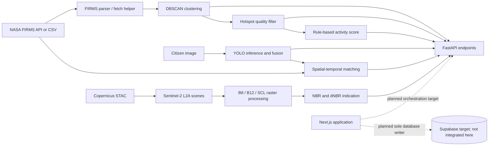

# BaraWatch AI Service

**Hotspot intelligence, image evidence, and satellite change analysis for wildfire monitoring.**

BaraWatch AI is a Python 3.11+ FastAPI service that exposes independent computations for hotspot clustering, image-based fire/smoke detection, report-to-hotspot matching, hotspot quality review, heuristic activity scoring, and Sentinel-2 spectral-change estimation. It is a decision-support component; it is not an emergency dispatch system, authoritative fire report, or substitute for ground verification.

The service does not write to a database. The Next.js application is a separate monorepo application and is an intended integration/orchestration target; current web API routes return fixture data or explicit “not configured” responses. NASA FIRMS and Copernicus are called directly only by their respective AI helpers/scripts, not by a unified pipeline endpoint.

## Capabilities

| Capability | Input → output | Endpoint | Status |
|---|---|---|---|
| Health and internal ping | Service settings → liveness or ping JSON | `GET /health`, `GET /v1/ping` | Implemented; health does not probe dependencies |
| Hotspot clustering | Hotspot records → time-segmented Haversine DBSCAN clusters | `POST /v1/cluster` | Implemented |
| Vision detection | JPEG/PNG → per-model detections, boxes, and fused labels | `POST /v1/vision/detect` | Implemented; local checkpoint files and API key required |
| Spatial-temporal matching | Report evidence plus hotspot candidates → review decision and score | `POST /v1/matching/score` | Implemented; heuristic |
| Hotspot filtering | FIRMS-like hotspot fields → eligible/review reasons | `POST /v1/hotspots/filter` | Implemented; not a false-positive classifier |
| Risk scoring | Aggregated hotspot counts and FRP → activity index | `POST /v1/risk/score` | Implemented; uncalibrated heuristic, not fire probability |
| Burn-area estimation | Location and date windows → dNBR change indication and coverage | `POST /v1/burn-area/estimate` | Implemented; live upstream reliability not currently verified |

## Architecture



These are separate modules and endpoints, not an automatically executed pipeline. Details and implementation boundaries are in [Architecture](docs/ARCHITECTURE.md) and [Data Pipeline](docs/DATA_PIPELINE.md).

## Technology

- Python 3.11+, FastAPI, Pydantic Settings, Uvicorn.
- NumPy, scikit-learn DBSCAN, Shapely, Pillow, Ultralytics YOLO.
- Rasterio, PyProj, boto3, NumPy for the separate Copernicus burn-area dependency set.
- NASA FIRMS CSV Area API (VIIRS/MODIS products) and Copernicus Data Space STAC/S3 with Sentinel-2 L2A.
- Docker Compose; CPU-first Docker image. Model checkpoints are local ignored files, not embedded in the image.

## Quick start

Run from this directory (`apps/ai-service`). Python 3.11 is the documented runtime; `pyproject.toml` accepts Python `>=3.11,<3.14`.

```sh
python3.11 -m venv .venv
source .venv/bin/activate
python -m pip install --upgrade pip
python -m pip install -e '.[dev]'
cp .env.example .env
python -m uvicorn app.main:app --reload --host 127.0.0.1 --port 8000
```

Set a strong `AI_INTERNAL_KEY` and `BARAWATCH_AI_API_KEY` in a local, untracked `.env` before using protected endpoints. Staging/production require an internal key of at least 32 characters. Keep keys server-side; do not put them in browser code. For vision requests, provision the two local model files described in [Deployment](docs/DEPLOYMENT.md). For burn-area processing, install `requirements-copernicus.txt` and configure CDSE S3 credentials. Variables read directly through `os.getenv` must be exported to the process; merely loading a Pydantic setting from `.env` does not export it.

OpenAPI/Swagger: `http://127.0.0.1:8000/docs` and `http://127.0.0.1:8000/openapi.json`. Health check: `http://127.0.0.1:8000/health`.

Docker Compose, from this directory:

```sh
docker compose config
docker compose up --build -d
docker compose ps
curl -f http://localhost:8000/health
```

Compose reads `.env`, publishes port `8000` by default, mounts model weights read-only, uses a read-only container root with `/tmp` tmpfs, and forces CPU. See [Deployment](docs/DEPLOYMENT.md). Docker requires a running Docker daemon.

## API overview

All current routes are listed in [API Reference](docs/API_REFERENCE.md):

- `GET /health`
- `GET /v1/ping`
- `POST /v1/cluster`
- `POST /v1/vision/detect`
- `POST /v1/matching/score`
- `POST /v1/hotspots/filter`
- `POST /v1/risk/score`
- `POST /v1/burn-area/estimate`

## Development and tests

```sh
cd apps/ai-service
./.venv/bin/python -m pytest -q
./.venv/bin/python -m ruff check app tests
./.venv/bin/python -m compileall -q app tests experiments
```

Latest documentation-time verification: **74 tests passed**, with two dependency deprecation warnings. These tests do not establish field accuracy or upstream availability. See [Testing](docs/TESTING.md) for coverage boundaries.

## Current status and limitations

- A documentation-time live burn-area request attempt was blocked by DNS resolution to the Copernicus STAC host; raster reading was not reached. Docker smoke testing was also unavailable because the local Docker daemon could not be reached.
- Historical outputs in `outputs/` include an earlier successful dNBR result. They are artifacts, not a fresh reproducibility or accuracy claim.
- FIRMS detections and Sentinel-2 dNBR changes are not independent wildfire ground truth. Risk and matching values are heuristics; model accuracy has no verified metrics in this repository.
- The raster cache has atomic file replacement but no size/age eviction policy and only a nonzero-size reuse check.
- Full end-to-end integration tests and production readiness are not established.
- The repository currently contains zero-byte GitHub Actions workflow files; they do not provide active CI/deployment verification.

For evidence and distinctions between confirmed, historical, and unverified findings, see [Limitations](docs/LIMITATIONS.md) and [Validation Report](docs/VALIDATION_REPORT_2026-10-31.md).

## Documentation index

- [Architecture](docs/ARCHITECTURE.md) · [Features](docs/FEATURES.md) · [API Reference](docs/API_REFERENCE.md)
- [Third-party services](docs/THIRD_PARTY_SERVICES.md) · [Data pipeline](docs/DATA_PIPELINE.md) · [Models and algorithms](docs/MODELS_AND_ALGORITHMS.md)
- [Configuration](docs/CONFIGURATION.md) · [Development](docs/DEVELOPMENT.md) · [Testing](docs/TESTING.md)
- [Deployment](docs/DEPLOYMENT.md) · [Security](docs/SECURITY.md) · [Troubleshooting](docs/TROUBLESHOOTING.md)
- [Limitations](docs/LIMITATIONS.md) · [Roadmap](docs/ROADMAP.md)
- Existing records: [AI audit report](docs/AI_AUDIT_REPORT.md), [validation report](docs/VALIDATION_REPORT_2026-10-31.md), [test results](docs/TEST_RESULTS.md), [vision model contract](docs/VISION_MODEL_CONTRACT.md), [Docker deployment notes](docs/DOCKER_DEPLOYMENT.md).

## License and acknowledgments

No repository-level license file was found during inspection. A license for this project has not been specified. Third-party model licenses are separate and must be checked before redistribution or commercial use. BaraWatch uses data/services provided by NASA FIRMS and Copernicus Data Space; consult their linked terms and attribution guidance.
