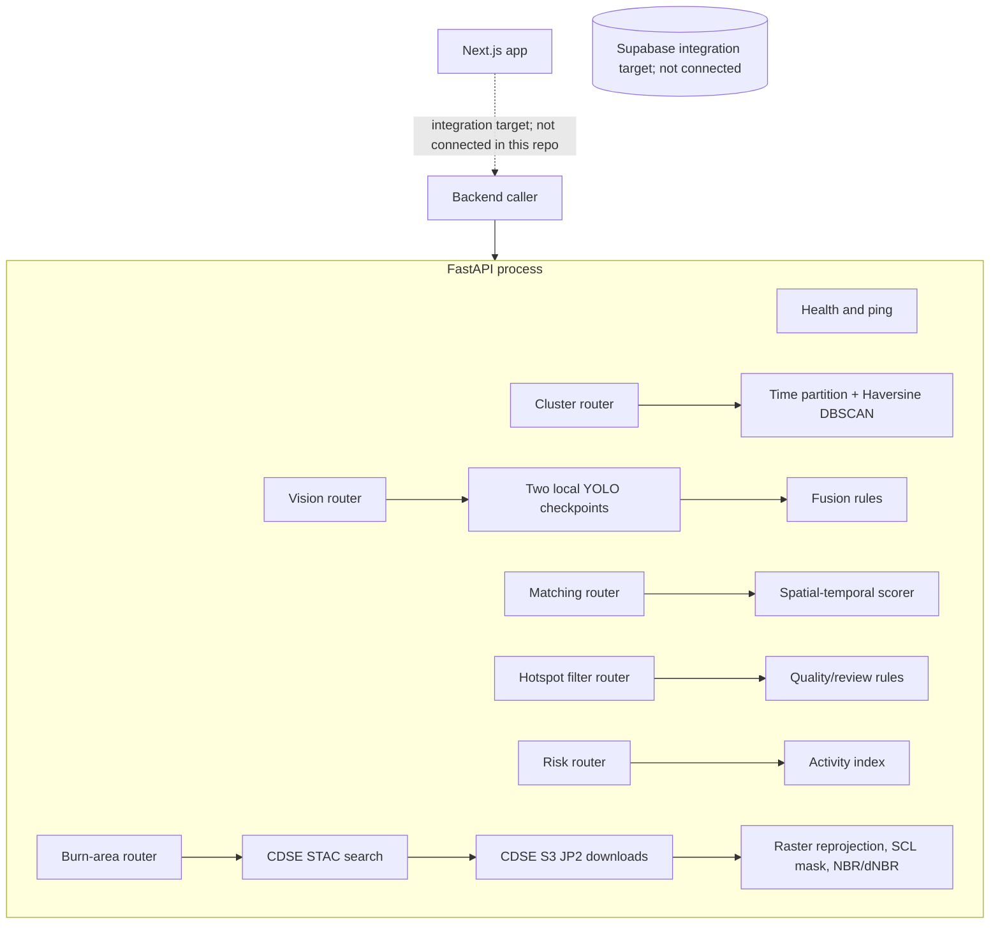

# Architecture

## Runtime boundary

`app/main.py` creates one FastAPI app and registers eight route operations. Routers validate requests, enforce endpoint authentication, call a service, and serialize responses. The services are stateless computations apart from lazy in-process YOLO model instances and local raster/output files. There is no database client or database write path in this service.

The dotted browser/DB links are architectural intent only. The current Next.js public API handlers in the monorepo use local dummy fixtures; its WhatsApp webhook returns HTTP 501 and hotspot cron handler states ingestion is not configured. There is no Supabase or Twilio dependency in the web package inspected for this documentation.

## Registered endpoints

| Router | Operations | Main service |
|---|---|---|
| `app/api/health.py` | `GET /health` | Pydantic settings snapshot |
| `app/api/v1/system.py` | `GET /v1/ping` | Constant internal ping response |
| `app/api/v1/cluster.py` | `POST /v1/cluster` | `services/clustering/dbscan.py` |
| `app/api/v1/vision.py` | `POST /v1/vision/detect` | `services/vision/detector.py`, `fusion.py` |
| `app/api/v1/matching.py` | `POST /v1/matching/score` | `services/matching/spatiotemporal.py` |
| `app/api/v1/hotspot_filter.py` | `POST /v1/hotspots/filter` | `services/filtering/hotspot_quality.py` |
| `app/api/v1/risk.py` | `POST /v1/risk/score` | `services/risk/rule_based.py` |
| `app/api/v1/burn_area.py` | `POST /v1/burn-area/estimate` | `services/burn_area/` modules |

## Data and state

- Hotspot, report, and score requests are supplied by the caller. The API does not fetch FIRMS as part of `/v1/cluster` or connect results to a database.
- `services/firms.py` can fetch and parse FIRMS CSV. `scripts/run_hotspots.py --fetch` uses it; this is not an HTTP endpoint.
- Vision loads configured local checkpoints on demand and caches model objects in the process with `lru_cache`.
- Burn-area assets are downloaded to a SHA-256-named local cache under `/tmp/barawatch-burn-area-cache` by default. Temporary files are atomically renamed. There is no cache eviction policy.
- GeoTIFF output is optional and defaults under `outputs/burn_area`; it requires a writable filesystem path.

## Cross-module orchestration

No route runs a multi-stage FIRMS→filter→cluster→risk or vision→matching workflow automatically. The endpoint caller must pass outputs into subsequent requests. Burn-area estimation is one route and calls STAC, S3, and raster computation internally. See [Data Pipeline](DATA_PIPELINE.md).

## Request logging

`app/main.py` adds a request ID response header and logs method, path, status, and duration with a JSON formatter. Burn-area logs additionally record scene IDs and pixel/coverage counts. The logging formatter does not intentionally include authentication header values.
