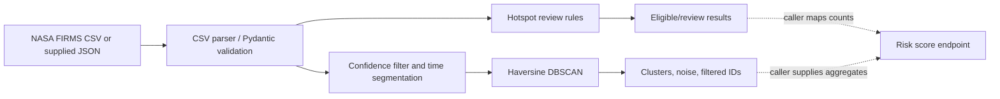

# Data pipelines

The service exposes independent endpoints and does not run the complete monorepo workflows itself. A caller can chain service outputs, but no orchestration endpoint exists.

## Hotspot data

`services/firms.py` supports CSV parsing and an authenticated NASA FIRMS Area API download. `scripts/run_hotspots.py --fetch` connects fetch, parsing and clustering for a command-line workflow; no HTTP ingestion route exists. The `/v1/cluster` endpoint accepts JSON hotspots supplied by the caller. `/v1/hotspots/filter` is a separate endpoint taking FIRMS-like fields. `/v1/risk/score` takes aggregate counts; it does not inspect clusters or fetch observations. These modules are not automatically chained.

FIRMS timestamps are parsed as UTC by the CSV helper. API hotspot timestamps must include a timezone for clustering and matching. Coordinates use latitude/longitude degrees; distance calculations use a spherical Haversine approximation. Duplicate hotspot IDs are rejected by clustering. The quality filter preserves each input record; it does not deduplicate. NASA active-fire detections are satellite observations and are not confirmed ground truth.

## Citizen image evidence

```mermaid
flowchart LR
  Upload[Client upload JPEG/PNG] --> Validate[Auth, MIME/format, size and pixel limits]
  Validate --> RGB[Decode and convert to RGB]
  RGB --> Models[Two local YOLO checkpoints]
  Models --> Dets[Per-model classes, confidences and pixel boxes]
  Dets --> Fusion[Rule-based class fusion]
  Fusion --> JSON[Vision response JSON]
  JSON -. separate caller request .-> Match[Matching with report location/time and hotspot candidates]
  Match --> Review[auto_pass or uncertain screening result]
```

Vision and matching are separate requests. The matching caller supplies scores and hotspot candidate timestamps/coordinates. Matching requires timezone-aware timestamps, uses WGS84 latitude/longitude and can only produce `auto_pass` under restrictive rules; otherwise it marks the case for review. The output is a screening result, not a human-confirmed incident.

## Burn-area processing

```mermaid
flowchart LR
  Request[Location, radius and pre/post date windows] --> Query[CDSE STAC search]
  Query --> Select[Cloud metadata filter and deterministic scene order]
  Select --> Assets[S3 B8, B12, SCL downloads]
  Assets --> Grid[Circle clipped to 20 m local UTM grid]
  Grid --> Mask[SCL clear classes + nodata and positive corrected DN]
  Mask --> NBR[Per-scene NBR, median composite per period]
  NBR --> Delta[dNBR = pre NBR - post NBR]
  Delta --> Area[Pixels above threshold; overlap coverage]
  Area --> Response[Areas, coverage, scene IDs and limitations]
```

The STAC query uses a geographic bounding-box approximation around the requested location; raster processing clips to a projected circular region. The selected aliases prefer `B08_10m` for B8, `B12_20m` for B12, and `SCL_20m` for SCL, with other listed aliases as fallbacks. Numeric bands are bilinearly resampled; categorical SCL uses nearest-neighbor. A masked pixel is excluded. SCL clear set is `{2, 4, 5}`. Code subtracts 1000 DN from B8/B12 and notes that the offset depends on product baseline; source metadata is not inspected at runtime.

Per-period composites are pixelwise median across usable scenes. Valid coverage is the common clear pixels divided by the circular grid pixels. Every pixel represents nominally 20 m × 20 m (0.04 ha) before local projection/border approximation. Indicated area sums pixels whose dNBR is greater than or equal to the request threshold. This output is not independently confirmed burned area.

Each raster asset is downloaded to a SHA-256-named local JP2 cache file; downloads use a temporary file and atomic rename, and files of nonzero size are reused. There is no age/size eviction or strong integrity validation. Failed per-scene asset reads are logged and the scene is skipped; if no usable scene or no pre/post overlap remains, the request fails. The endpoint does not silently convert unavailable imagery to a successful empty result.
